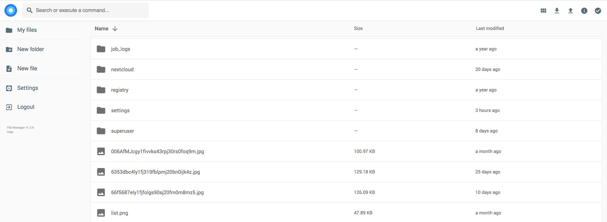

Aria2 + AriaNg

[English](https://github.com/wahyd4/aria2-ariang-docker/blob/master/README.md) | 简体中文

> 🚨 注意：由于本人精力有限，现决定将主要精力放在更新功能，和英文版本文档。中文版本文档即日起暂停更新，欢迎志愿者对英文说明进行翻译或者赞助本项目，助力我投入更多时间。谢谢。（2022年4月19日）

[](https://microbadger.com/images/wahyd4/aria2-ui "Get your own image badge on microbadger.com")
[](https://hub.docker.com/r/wahyd4/aria2-ui/)
[](https://github.com/wahyd4/aria2-ariang-docker/actions)


[](https://badges.toozhao.com/stats/01EJ791D8BB43PDS8D7PP7H0YE "Get your own page views count badge on badges.toozhao.com")

**如果你喜欢这个项目，请考虑微信打赏，让我更有动力来不断更新，谢谢！**


本镜像包含 Aria2、AriaNg 和File Manager，主要方便那些用户期望只运行一个镜像就能实现图形化下载文件和在线播放文件。（类似离线下载的功能），只使用一个 Docker 镜像也方便用户在群晖NAS 中运行本程序。

- [功能特性](#功能特性)
- [推荐使用的docker image tag](#推荐使用的docker-image-tag)
- [安装与运行](#安装与运行)
  - [快速运行](#快速运行)
  - [开启所有功能](#开启所有功能)
  - [使用docker-compose 运行](#使用docker-compose-运行)
  - [支持的 Docker 环境变量](#支持的-docker-环境变量)
  - [支持的 Docker volume 属性](#支持的-docker-volume-属性)
- [自动 SSL](#自动-ssl)
- [自行构建镜像](#自行构建镜像)
- [Docker Hub](#docker-hub)
- [在 Kubernetes 里面运行 (我的最爱)](#在-kubernetes-里面运行-我的最爱)
- [使用 Docker compose 来运行](#使用-docker-compose-来运行)
- [常见问题](#常见问题)

AriaNG


File Browser


## 功能特性

  * [Aria2](https://aria2.github.io) 文件下载工具(支持SSL )
  * [AriaNg](https://github.com/mayswind/AriaNg) 通过 UI 来操作，下载文件
  * [Rclone](https://rclone.org) 同步文件到云盘
  * 自动 HTTPS （Let's Encrypt）
  * 支持绑定自定义用户ID，可以主机上的非`root`用户，也可以管理下载的文件
  * Basic Auth 用户认证
  * 文件管理和视频播放 ([FileBrowser](https://filebrowser.org/)，注意默认情况下，只能访问和管理 `/data` 目录下的文件)
  * 支持ARM CPU 架构，因此可以在树莓派等设备上运行，

## 推荐使用的docker image tag

* wahyd4/aria2-ui:latest

> Docker会为你自动选择对应CPU平台的image. e.g. arm64v8 或者 x86_64 平台

## 安装与运行

### 快速运行

```bash
  docker run -d --name aria2-ui -p 80:80 wahyd4/aria2-ui
```

* Aria2: <http://yourip>
* Caddy 文件服务器（只读）: <http://yourip/ro>
* Filebrowser: <http://yourip/files>
* Rclone: <http://yourip/rclone>
* Filebrowser 首次启动的 `admin` 密码是随机生成的，请查看 docker 日志中类似 `User 'admin' initialized with randomly generated password: xxx` 的输出，然后用该密码登录 Filebrowser。
* 如果没有修改 `ARIA2_USER`、`ARIA2_PWD`，请使用 `user`/`password` 登录 `Rclone`。
* 这里不需要设置 `ARIA2_EXTERNAL_PORT`：AriaNg 会从页面自身的 URL 推导 aria2 RPC 端口。只有当浏览器访问应用的端口与页面所在端口不同时，才需要设置它。

> **安全提示：** 上面的快速运行命令会在无任何认证的情况下暴露 AriaNg、FileBrowser 和 Rclone。如果要暴露到公网，请设置 `ENABLE_AUTH=true`、足够强的 `ARIA2_PWD`、`RPC_SECRET`，并通过 HTTPS 提供服务（例如 `DOMAIN=https://example.com`）。AriaNg 应与 RPC 接口同源访问（默认的 Caddy 配置已满足）；跨源自建前端需要在自己的 `aria2.conf` 中设置 `rpc-allow-origin-all=true`。注意：`ENABLE_AUTH` 只保护 AriaNg、只读的 `/ro` 和 aria2 RPC 接口；`/files` 使用 File Browser 自己的管理员登录，`/rclone` 使用 `ARIA2_USER`/`ARIA2_PWD`，不受 `ENABLE_AUTH` 影响。
>
> **注意：** File Browser 上游已于 2026-09-01 归档，不再提供安全修复。本镜像固定使用其最后一个版本（`v2.63.23`），长期使用请评估替代方案。
### 开启所有功能

请先创建宿主机目录和文件。特别注意要提前创建 File Browser 的数据库文件：如果宿主机上的文件不存在，Docker 会在 `/app/filebrowser.db` 创建目录，导致容器无法启动。请从本项目检出目录复制**整个** `conf/` 文件夹——`aria2.conf` 会调用 `/app/conf/auto-upload.sh` 和 `/app/conf/aria2-sample-hook.sh`，只复制 `aria2.conf` 和 `aria2.session` 会让这些钩子缺失。

```bash
  mkdir -p /yourdata /yourcache /yourcaddy /yourconf
  cp -r conf/. /yourconf/
  touch /yourdata/filebrowser.db

  docker run -d --name ariang \
  -p 80:80 \
  -p 443:443 \
  -p 6881-6999:6881-6999/tcp \
  -p 6881-6999:6881-6999/udp \
  -e PUID=1000 \
  -e PGID=1000 \
  -e ENABLE_AUTH=true \
  -e RPC_SECRET=Hello \
  -e DOMAIN=https://example.com \
  -e ARIA2_USER=user \
  -e ARIA2_PWD=password \
  -e CADDY_LOG_LEVEL=ERROR \
  -v /yourdata:/data \
  -v /yourcache:/app/.cache \
  -v /yourdata/filebrowser.db:/app/filebrowser.db \
  -v /yourcaddy:/app/.caddy \
  -v /yourconf:/app/conf \
  wahyd4/aria2-ui
```

`ARIA2_SSL` 已废弃并被忽略，因此示例不再挂载 `/app/conf/key`：Caddy 负责 TLS，aria2 RPC 只监听 `127.0.0.1`。示例同样省略了 `ARIA2_EXTERNAL_PORT`，因为 AriaNg 会从 `https://example.com` 推导出 `443`；只有当浏览器访问应用的端口与页面所在端口不同时，才需要设置它。
### 使用docker-compose 运行

如果你不想记住那些命令行，你也可以使用docker-compose来将配置放在`docker-compose.yaml`文件中
```yaml
version: "3.5"
services:
  aria2-ui:
    restart: unless-stopped
    image: wahyd4/aria2-ui:latest
    environment:
      - ENABLE_AUTH=true
      - ARIA2_USER=hello
      - ARIA2_PWD=world
      - DOMAIN=http://toozhao.com
    volumes:
      - ./data:/data
```
然后使用 `docker-compose up -d` 运行即可

### 支持的 Docker 环境变量

  * `ENABLE_AUTH` 启用 Basic auth（网页简单认证），只保护 AriaNg、只读的 `/ro` 和 aria2 RPC 接口；`/files`（File Browser）和 `/rclone`（Rclone）使用各自的登录，不受影响。可选值为 `true`、`false`、`heroku`；在 Heroku 上运行时必须设为 `heroku`，并使用 Heroku 提供的 `PORT` 环境变量。
  * `ENABLE_RCLONE` 是否启用 Rclone，默认 `true`。Rclone 首次运行需要从 GitHub 下载文件；如果下载失败，只有 `/rclone/` 不可用，程序其它部分仍会正常运行，此时可以将其设为 `false`。
  * `ENABLE_FILEBROWSER` 是否启用 File Browser，默认 `true`；设为 `false` 可关闭。
  * `ARIA2_USER` Basic Auth 用户认证用户名，Rclone也使用该参数
  * `ARIA2_PWD` Basic Auth 密码，Rclone也使用该参数
  * `ARIA2_EXTERNAL_PORT` 可选。浏览器访问 AriaNg 的公网端口。不设置时，AriaNg 会从页面自身的 URL 推导 RPC 端口；只有当浏览器访问应用的端口与页面所在端口不同时，才需要设置。
  * `ARIA2_SSL` **已废弃并被忽略**。aria2 RPC 现在只监听 `127.0.0.1`，由 Caddy 终止 TLS，旧的证书配置不再生效；设置它只会输出一条警告。
  * `CADDY_FILE_SERVER_BROWSE_HTML` Caddy 只读文件浏览器 `/ro` 使用的 HTML 模板路径，默认 `/app/browse.html`。
  * `PORT` 仅用于 Heroku：Heroku 分配的监听端口，在 `ENABLE_AUTH=heroku` 时由 Caddy 使用。其它环境不要设置。
  * `PUID` 需要绑定主机的Linux用户ID，可以通过`cat /etc/passwd` 查看用户列表， 默认UID 是`1000`。必须与 `PGID` 保持一致：要么两者都是 `0`（用 root 运行），要么两者都非 `0`（用普通用户运行），混用会导致启动失败。
  * `PGID` 需要绑定的主机的Linux 用户组ID，默认GID 是`1000`
  * `RPC_SECRET` Aria2 RPC 加密 token。不能包含换行，也不能以空白字符开头或结尾（aria2 会 trim 配置文件中的值，导致 AriaNg 与 RPC 不一致）。
  * `DOMAIN` 绑定的域名, 当绑定的域名为`HTTPS`时，即为启用`HTTPS`， 例： `DOMAIN=https://toozhao.com`
  * `RCLONE_CONFIG_BASE64` 通过`base64` 字符串的形式配置rclone.conf。主要给在Heroku平台上运行时使用，请使用命令行 `cat /app/conf/rclone.conf | base64` 或者其他任何在线base64在线工具 [比如这个](https://www.base64encode.org/)来把`rclone.conf`的内容生成`base64`字符串。在使用本环境变量的同时，请确保`ENABLE_RCLONE`设置为`true`。
  * `ENABLE_APP_CHECKER`，默认情况下本程序会每天向远程服务器发送一次GET请求，以检查是否有新版本的镜像。该功能可以让你及时获取新功能和相关安全隐患的修复的推送提醒。你也可以选择将该环境变量设置为`false`来禁用该功能。注意该功能启用下，依然需要手动更新镜像来完成升级。
  * `CADDY_LOG_LEVEL` Caddy 的日志级别，设为 `WARN` 或 `ERROR` 可减少日志输出，默认 `INFO`。
  * `RCLONE_AUTO_UPLOAD_PROVIDER` 自动上传使用的 rclone 远端名（在 `Rclone -> Configs` 中可查），默认 `""`，即关闭自动上传；设置后下载完成的文件会尝试上传。
  * `RCLONE_AUTO_UPLOAD_REMOTE_PATH` 远端存储中的目标目录，默认 `/downloads`。
  * `RCLONE_AUTO_UPLOAD_FILE_MIN_SIZE` 自动上传的最小文件大小，小于该值的文件不上传，默认 `1K`。
  * `RCLONE_AUTO_UPLOAD_FILE_MAX_SIZE` 自动上传允许的最大文件大小，默认 `100G`。
  * `FIX_DATA_VOLUME_PERMISSIONS` 默认 `false`；设为 `true` 时容器会对 `/data` 执行 `chown -R` 到 `PUID`/`PGID`。当容器提示没有权限管理挂载的文件和目录时，把它设为 `true`。

配置错误（例如 `ENABLE_AUTH` 值非法，或 `ENABLE_AUTH=true` 但 `ARIA2_PWD` 为空）会让容器以非零状态退出，而不是带着错误配置继续运行。


### 支持的 Docker volume 属性
  * `/data` 用来放置所有下载的文件的目录
  * `/app/conf/key` **已废弃**。以前用于放置 aria2 RPC 的证书（`aria2.crt`）和私钥（`aria2.key`）。现在 aria2 RPC 只监听 `127.0.0.1`，由 Caddy 终止 TLS，该挂载不再有任何作用。
  * `/app/conf` 该目录用于放置 aria2 配置、下载会话、rclone 配置和钩子脚本。请把本项目 `conf/` 目录下的**所有文件**复制过去，而不是只复制 `aria2.conf` 和 `aria2.session`：`aria2.conf` 会调用 `/app/conf/auto-upload.sh`（下载完成时）和 `/app/conf/aria2-sample-hook.sh`（下载失败时），缺少这些脚本会导致钩子失效。第一次使用 `aria2.session` 时，创建一个空文件即可。不挂载 `/app/conf` 时，容器重启（restart）不会丢失下载进度；只有重建或升级容器（recreate/upgrade）才会丢失。支持的配置文件为：
    * aria2.conf
    * aria2.session
    * rclone.conf
    * auto-upload.sh
    * aria2-sample-hook.sh
  * `/app/filebrowser.db` File Browser 的设置数据库，包含 `admin` 账号和密码。请先在宿主机创建一个空文件再挂载，否则 Docker 会创建目录，File Browser 无法启动。不挂载时，容器重建或升级后该文件会丢失。
  * `/app/.caddy` Caddy 的数据目录，包含 Let's Encrypt 证书和私钥。挂载它可以避免容器重建后重新签发证书。
  * `/app/.cache` 用于存放 rclone 缓存和 [aria2 DHT 文件](https://aria2.github.io/manual/en/html/aria2c.html#cmdoption-dht-file-path) 的目录。

## 自动 SSL

请在绑定域名前，设置`DNS`的一条`A`记录，将运行docker的主机IP绑定到该域名。然后你仅仅需要在运行时添加`e`设置即可。

```bash
docker run -d --name aria2-ui -p 80:80 -p 443:443 -e DOMAIN=https://toozhao.com wahyd4/aria2-ui
```

## 自行构建镜像

```
docker build -t aria2-ui .
```

`docker build` 只会构建当前主机架构的镜像，并加载到本地 Docker。需要多架构镜像时请用 `docker buildx build`，并加上 `--push`（或单架构时加 `--load`）；两者都不加时，构建结果只留在构建缓存里，`docker run` 找不到该镜像。

## Docker Hub

  <https://hub.docker.com/r/wahyd4/aria2-ui/>

## 在 Kubernetes 里面运行 (我的最爱)

首先，在Kubernetes 里面运行本Docker 镜像比在Docker 里面更加复杂，需要更多的相关知识，但是也更加有意思，给你带来更多的折腾之后的满足。
你可以使用`minikube`，Docker 桌面应用自带Kubernetes 或者 使用`kubeadm`来安装Kubernetes，然后你需要根据自己的需要修改 [k8s-manifest.yaml](k8s-manifest.yaml) 来满足你的需要的需求。比如：

* NFS PV provider(使用NAS 作为容器存储)
* Ingress 访问, Oauth 登录灯其他访问控制
* VPN (让数据访问更加安全)
* 其他的一些 Sidecars

## 使用 Docker compose 来运行

  请参考 <https://github.com/wahyd4/aria2-ariang-x-docker-compose>

## 常见问题
  1. 出现`Aria2 状态 未连接`通常表示浏览器无法连到 AriaNg 推导出的 RPC 端口。默认情况下 AriaNg 会从页面 URL 推导端口，因此 `-p 8000:80` 或 HTTPS 反向代理无需额外设置。只有当浏览器访问应用的端口与页面所在端口不同时，才需要设置`ARIA2_EXTERNAL_PORT`并重建容器。
  2. 下载的BT或者磁力完全没有速度怎么办？ 建议先下载一个热门的BT种子文件，而不是磁力链接。这样可以帮助缓存DHT文件，渐渐地，速度就会起来了。比如试试下载树莓派操作系统的BT种子？[前往下载](https://www.raspberrypi.org/downloads/raspbian/)。另外请发布 BT 监听端口范围（`-p 6881-6999:6881-6999/tcp -p 6881-6999:6881-6999/udp`）；没有入站 peer 时 DHT 和 peer 数量都会很少，下载会很慢。
  3. 如果你遇到了和 `setcap` 相关的错误，很大程度说明你说运行的Linux不支持使用非`root`用户来运行本Docker 镜像，因此请显式地设置环境变量`PUID`  `PGID` 为 `0` ，也就是使用`root` 来运行
  4. 如何配置`Rclone`? 如果你想连接`Google Drive` 类似的云存储平台，很遗憾你不能通过浏览器配置，因为网页版本`Oauth` 方式在这里是用不了的，你只能通过命令行的形式来配置，即`rclone config`. 详请请参考官网 [Configuring rclone on a remote / headless machine](https://rclone.org/remote_setup) 以及详细步骤请参考 [issue](https://github.com/wahyd4/aria2-ariang-docker/issues/118)
  5. 挂载了 `-v /<some-folder>:/app/conf` 之后应用无法启动？这是把整个 `/app/conf` 挂载过去、但宿主机目录是空的导致的。请把本项目 [`conf`](https://github.com/wahyd4/aria2-ariang-docker/tree/master/conf) 目录下的**所有文件**都复制到该目录再重新运行容器——不要只复制 `aria2.conf` 和 `aria2.session`，`aria2.conf` 还会调用 `/app/conf/auto-upload.sh` 和 `/app/conf/aria2-sample-hook.sh`。
