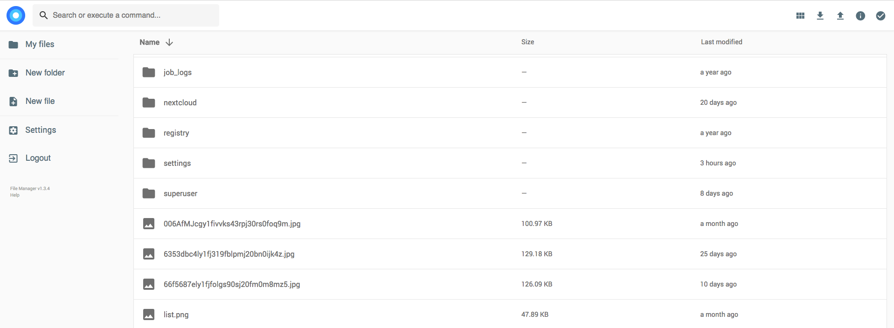

Aria2 + AriaNg + Filebrowser

[English](https://github.com/wahyd4/aria2-ariang-docker/blob/master/README.md) | 简体中文

[](https://microbadger.com/images/wahyd4/aria2-ui "Get your own image badge on microbadger.com")
[](https://hub.docker.com/r/wahyd4/aria2-ui/)
[](https://github.com/wahyd4/aria2-ariang-docker/actions)


**如果喜欢这个项目，欢迎[赞助我](https://github.com/sponsors/wahyd4)或微信打赏，谢谢！**


一个 Docker 镜像就够了：下载、管理、分享文件，在线播放视频，还能把文件同步到云盘。

镜像体积不大，也支持 ARM 架构，树莓派也能跑🍓。

自动 HTTPS 也只要加一个参数。

- [功能特性](#功能特性)
- [推荐使用的 Docker 镜像 tag](#推荐使用的-docker-镜像-tag)
- [安装与运行](#安装与运行)
  - [快速运行](#快速运行)
  - [开启所有功能](#开启所有功能)
  - [使用 docker-compose 运行](#使用-docker-compose-运行)
  - [Rootless Podman](#rootless-podman)
  - [支持的 Docker 环境变量](#支持的-docker-环境变量)
  - [支持的 Docker volume 属性](#支持的-docker-volume-属性)
- [自动 SSL](#自动-ssl)
- [下载自动化 🤖](#下载自动化-)
  - [用 iPhone/Mac 快捷指令下载](#用-iphonemac-快捷指令下载)
  - [用 cURL 下载](#用-curl-下载)
- [自行构建镜像](#自行构建镜像)
- [Docker Hub](#docker-hub)
- [在 Kubernetes 里面运行 (我的最爱)](#在-kubernetes-里面运行-我的最爱)
- [使用 Docker compose 来运行](#使用-docker-compose-来运行)
- [常见问题](#常见问题)

AriaNG


File Browser


## 功能特性

  * [Aria2](https://aria2.github.io) 下载工具，支持 SSL
  * [AriaNg](https://github.com/mayswind/AriaNg) 网页控制台，图形化操作下载
  * [Rclone](https://rclone.org) 同步文件到云盘
  * 自动 HTTPS（Let's Encrypt）
  * 支持绑定自定义用户 ID：用宿主机上的非 `root` 用户运行，也能管理下载的文件
  * Basic Auth 认证
  * 文件管理和视频播放 ([FileBrowser](https://filebrowser.org/)，默认只能访问和管理 `/data` 目录下的文件)
  * 支持 ARM CPU 架构，树莓派等设备也能跑
  * 云盘同步
  * 下载完成后自动上传到第三方云存储（通过 Rclone）

## 推荐使用的 Docker 镜像 tag

* wahyd4/aria2-ui:latest

> Docker 会自动选择对应 CPU 平台的镜像，例如 arm64v8 或 x86_64。

## 安装与运行

### 快速运行

```bash
  docker run -d --name aria2-ui -p 8000:80 wahyd4/aria2-ui
```

* Aria2: <http://yourip:8000>
* Caddy 文件服务器（只读）: <http://yourip:8000/ro>
* Filebrowser: <http://yourip:8000/files>
* Rclone: <http://yourip:8000/rclone>
* Filebrowser 首次启动的 `admin` 密码是随机生成的，查看 docker 日志里 `User 'admin' initialized with randomly generated password: xxx` 这一行，用该密码登录 Filebrowser。
* 如果没有改 `ARIA2_USER`、`ARIA2_PWD`，用 `user`/`password` 登录 `Rclone`。

> **端口说明：** 上面的命令不用设置 `ARIA2_EXTERNAL_PORT`。AriaNg 会从页面自身的 URL 推导 aria2 RPC 端口；只有当浏览器访问应用的端口和页面所在端口不一样时，才需要设置。

> **安全提示：** 上面的快速运行命令会在无任何认证的情况下暴露 AriaNg、FileBrowser 和 Rclone。如果要暴露到公网，请设置 `ENABLE_AUTH=true`、足够强的 `ARIA2_PWD`、`RPC_SECRET`，并通过 HTTPS 提供服务（例如 `DOMAIN=https://example.com`）。AriaNg 应与 RPC 接口同源访问（默认的 Caddy 配置已满足）；跨源自建前端需要在自己的 `aria2.conf` 中设置 `rpc-allow-origin-all=true`。注意：`ENABLE_AUTH` 只保护 AriaNg、只读的 `/ro` 和 aria2 RPC 接口；`/files` 使用 File Browser 自己的管理员登录，`/rclone` 使用 `ARIA2_USER`/`ARIA2_PWD`，不受 `ENABLE_AUTH` 影响。
>
> **注意：** File Browser 上游已于 2026-09-01 归档，不再提供安全修复。本镜像固定使用其最后一个版本（`v2.63.23`），长期使用请评估替代方案。

### 开启所有功能

请先创建宿主机目录和文件。特别注意要提前创建 File Browser 的数据库文件：如果宿主机上的文件不存在，Docker 会在 `/app/filebrowser.db` 创建目录，导致容器无法启动。请从本项目检出目录复制**整个** `conf/` 文件夹——`aria2.conf` 会调用 `/app/conf/auto-upload.sh` 和 `/app/conf/aria2-sample-hook.sh`，只复制 `aria2.conf` 和 `aria2.session` 会让这些钩子缺失。

```bash
  mkdir -p /yourdata /yourcache /yourcaddy /yourconf
  cp -r conf/. /yourconf/
  touch /yourdata/filebrowser.db

  docker run -d --name ariang \
  -p 80:80 \
  -p 443:443 \
  -p 6881-6999:6881-6999/tcp \
  -p 6881-6999:6881-6999/udp \
  -e PUID=1000 \
  -e PGID=1000 \
  -e ENABLE_AUTH=true \
  -e RPC_SECRET=Hello \
  -e DOMAIN=https://example.com \
  -e ARIA2_USER=user \
  -e ARIA2_PWD=password \
  -e CADDY_LOG_LEVEL=ERROR \
  -v /yourdata:/data \
  -v /yourcache:/app/.cache \
  -v /yourdata/filebrowser.db:/app/filebrowser.db \
  -v /yourcaddy:/app/.caddy \
  -v /yourconf:/app/conf \
  wahyd4/aria2-ui
```

`ARIA2_SSL` 已废弃并被忽略，因此示例不再挂载 `/app/conf/key`：Caddy 负责 TLS，aria2 RPC 只监听 `127.0.0.1`。示例同样省略了 `ARIA2_EXTERNAL_PORT`，因为 AriaNg 会从 `https://example.com` 推导出 `443`；只有当浏览器访问应用的端口与页面所在端口不同时，才需要设置它。

### 使用 docker-compose 运行

不想敲这些命令的话，把配置写进 `docker-compose.yaml`：
```yaml
version: "3.5"
services:
  aria2-ui:
    restart: unless-stopped
    image: wahyd4/aria2-ui:latest
    environment:
      - ENABLE_AUTH=true
      - ARIA2_USER=user
      - ARIA2_PWD=password
      - DOMAIN=http://toozhao.com
    ports:
      - "80:80"
    volumes:
      - ./data:/data
```
然后使用 `docker-compose up -d` 运行即可

### Rootless Podman

rootless Podman 可以直接跑，前提是**容器在 user namespace 内以 uid 0 启动**。rootless Podman 默认就是这样：你的用户 ID 会映射成容器里的 uid 0，所以启动时需要的 `PUID`/`PGID`、`chown`、`setcap` 都能在 namespace 内完成。

```bash
podman run -d --name aria2-ui \
  -p 8000:80 \
  -e PUID=0 -e PGID=0 \
  --security-opt label=disable \
  -v /yourdata:/data \
  -v /yourconf:/app/conf \
  wahyd4/aria2-ui
```

* 不要加 `--userns=keep-id` 或 `--user`：它们会让容器以普通用户身份启动，`PUID`/`PGID`、`chown`、`setcap` 都无法执行，会报 `groupmod: Permission denied`。如果配置里必须保留 `userns_mode=keep-id`，改成 `--userns=keep-id:uid=0,gid=0`（Podman >= 4.3），同时保持 `PUID=0`、`PGID=0`。
* rootless 不能映射 1024 以下的宿主机端口，用 `-p 8000:80` 就行，容器里面仍然是 `:80`。
* Linux 上建议设 `PUID=0`、`PGID=0`：默认的 `PUID=1000` 在 rootless 里对应宿主机的 subuid（比如 `100999`），写不了挂载的 `/data`；设 `FIX_DATA_VOLUME_PERMISSIONS=true` 能写，但会把文件 chown 成 subuid，你自己反而管不了。`PUID=0`/`PGID=0` 时容器里的 uid 0 就是你，下载的文件还是你的。这个组合只适合 rootless，别照搬到 rootful Docker 或 Kubernetes 的 `runAsNonRoot`。
* SELinux 开启的主机（Fedora/RHEL）要给挂载加 `--security-opt label=disable`，否则容器会因 `mkdir ... Permission denied` 退出。

### 支持的 Docker 环境变量

  * `ENABLE_AUTH` 启用 Basic Auth（网页简单认证），只保护 AriaNg、只读的 `/ro` 和 aria2 RPC 接口；`/files`（File Browser）和 `/rclone`（Rclone）使用各自的登录，不受影响。可选值为 `true`、`false`。
  * `ENABLE_RCLONE` 是否启用 Rclone，默认 `true`。Rclone 首次运行需要从 GitHub 下载文件；如果下载失败，只有 `/rclone/` 不可用，程序其它部分仍会正常运行，此时可以将其设为 `false`。
  * `ENABLE_FILEBROWSER` 是否启用 File Browser，默认 `true`；设为 `false` 可关闭。
  * `ARIA2_USER` Basic Auth 用户名，Rclone 也用它
  * `ARIA2_PWD` Basic Auth 密码，Rclone 也用它
  * `ARIA2_EXTERNAL_PORT` 可选。浏览器访问 AriaNg 的公网端口。不设置时，AriaNg 会从页面自身的 URL 推导 RPC 端口；只有当浏览器访问应用的端口与页面所在端口不同时，才需要设置。
  * `ARIA2_SSL` **已废弃并被忽略**。aria2 RPC 现在只监听 `127.0.0.1`，由 Caddy 终止 TLS，旧的证书配置不再生效；设置它只会输出一条警告。
  * `CADDY_FILE_SERVER_BROWSE_HTML` Caddy 只读文件浏览器 `/ro` 使用的 HTML 模板路径，默认 `/app/browse.html`。
  * `PUID` 要绑定的宿主机 Linux 用户 ID（可以用 `cat /etc/passwd` 查），默认 `1000`。必须与 `PGID` 保持一致：要么两者都是 `0`（用 root 运行），要么两者都非 `0`（用普通用户运行），混用会导致启动失败。
  * `PGID` 要绑定的宿主机 Linux 用户组 ID，默认 `1000`
  * `RPC_SECRET` Aria2 RPC 加密 token。不能包含换行，也不能以空白字符开头或结尾（aria2 会 trim 配置文件中的值，导致 AriaNg 与 RPC 不一致）。
  * `DOMAIN` 要绑定的域名。值以 `https://` 开头时会自动申请证书并启用 HTTPS，例如 `DOMAIN=https://toozhao.com`。
  * `RCLONE_CONFIG_BASE64` 通过 `base64` 字符串的形式配置 rclone.conf，适合只能通过环境变量传配置、无法挂载 `/app/conf` 的平台。请使用命令行 `cat /path/to/rclone.conf | base64` 或者其他任何 base64 在线工具 [比如这个](https://www.base64encode.org/) 把 `rclone.conf` 的内容生成 `base64` 字符串。使用本环境变量的同时，请确保 `ENABLE_RCLONE` 设置为 `true`。
  * `ENABLE_APP_CHECKER` 默认 `true`，每天检查一次是否有新版本镜像，有新版本时在日志里提示。设为 `false` 可关闭。注意它只是提醒，升级还是要手动 pull 新镜像并重建容器。
  * `CADDY_LOG_LEVEL` Caddy 日志级别，设为 `WARN` 或 `ERROR` 可以少打日志，默认 `INFO`。
  * `RCLONE_AUTO_UPLOAD_PROVIDER` 自动上传使用的 rclone 远端名（在 `Rclone -> Configs` 中可查），默认 `""`，即关闭自动上传；设置后下载完成的文件会尝试上传。
  * `RCLONE_AUTO_UPLOAD_REMOTE_PATH` 远端存储中的目标目录，默认 `/downloads`。
  * `RCLONE_AUTO_UPLOAD_FILE_MIN_SIZE` 自动上传的最小文件大小，小于该值的文件不上传，默认 `1K`。
  * `RCLONE_AUTO_UPLOAD_FILE_MAX_SIZE` 自动上传允许的最大文件大小，默认 `100G`。
  * `FIX_DATA_VOLUME_PERMISSIONS` 默认 `false`。设为 `true` 时容器会对 `/data` 执行 `chown -R` 到 `PUID`/`PGID`，适合宿主机目录权限不对、下载报没权限的情况。

配置错误（例如 `ENABLE_AUTH` 值非法，或 `ENABLE_AUTH=true` 但 `ARIA2_PWD` 为空）会让容器以非零状态退出，而不是带着错误配置继续运行。


### 支持的 Docker volume 属性
  * `/data` 用来放置所有下载的文件的目录
  * `/app/conf/key` **已废弃**。以前用于放置 aria2 RPC 的证书（`aria2.crt`）和私钥（`aria2.key`）。现在 aria2 RPC 只监听 `127.0.0.1`，由 Caddy 终止 TLS，该挂载不再有任何作用。
  * `/app/conf` 该目录用于放置 aria2 配置、下载会话、rclone 配置和钩子脚本。请把本项目 `conf/` 目录下的**所有文件**复制过去，而不是只复制 `aria2.conf` 和 `aria2.session`：`aria2.conf` 会调用 `/app/conf/auto-upload.sh`（下载完成时）和 `/app/conf/aria2-sample-hook.sh`（下载失败时），缺少这些脚本会导致钩子失效。第一次使用 `aria2.session` 时，创建一个空文件即可。不挂载 `/app/conf` 时，容器重启（restart）不会丢失下载进度；只有重建或升级容器（recreate/upgrade）才会丢失。支持的配置文件为：
    * aria2.conf
    * aria2.session
    * rclone.conf
    * auto-upload.sh
    * aria2-sample-hook.sh
  * `/app/filebrowser.db` File Browser 的设置数据库，包含 `admin` 账号和密码。请先在宿主机创建一个空文件再挂载，否则 Docker 会创建目录，File Browser 无法启动。不挂载时，容器重建或升级后该文件会丢失。
  * `/app/.caddy` Caddy 的数据目录，包含 Let's Encrypt 证书和私钥。挂载它可以避免容器重建后重新签发证书。
  * `/app/.cache` 用于存放 rclone 缓存和 [aria2 DHT 文件](https://aria2.github.io/manual/en/html/aria2c.html#cmdoption-dht-file-path) 的目录。

## 自动 SSL

先把域名的 `A` 记录指向运行 Docker 的主机 IP，然后在运行时加上 `-e DOMAIN=https://你的域名` 即可。

```bash
docker run -d --name aria2-ui -p 80:80 -p 443:443 -e DOMAIN=https://toozhao.com wahyd4/aria2-ui
```

## 下载自动化 🤖

### 用 iPhone/Mac 快捷指令下载

先[下载快捷指令](https://www.icloud.com/shortcuts/7483b8cec7484c0f98b72882d0f1e3e2)，按提示填好 aria2-ui 的地址和 `RPC_SECRET`。之后运行快捷指令，输入要下载的文件地址（或者磁力/种子地址）就可以了。

### 用 cURL 下载

```bash
curl -u user:password https://example.com/jsonrpc \
  -d '{"jsonrpc":"2.0","id":"someID","method":"aria2.addUri","params":["token:Hello",["http://some_file_url"],{"dir":"/data"}]}'
```

把 `example.com` 换成你的域名和端口（`https://` 默认 443，否则要带上 `:端口`）。上面的账号密码对应“开启所有功能”的示例：`ENABLE_AUTH=true`、`ARIA2_USER=user`、`ARIA2_PWD=password`、`RPC_SECRET=Hello`。

## 自行构建镜像

```bash
docker build -t aria2-ui .
```

`docker build` 只会构建当前主机架构的镜像，并加载到本地 Docker。需要多架构镜像时请用 `docker buildx build`，并加上 `--push`（或单架构时加 `--load`）；两者都不加时，构建结果只留在构建缓存里，`docker run` 找不到该镜像。

## Docker Hub

  <https://hub.docker.com/r/wahyd4/aria2-ui/>

## 在 Kubernetes 里面运行 (我的最爱)

在 Kubernetes 里跑这个镜像比在 Docker 里复杂一些，需要多了解一点 Kubernetes，但折腾起来也更有意思。
可以用 `minikube`、Docker 桌面自带的 Kubernetes 或者 `kubeadm` 先装好集群，再按自己的需要改 [k8s-manifest.yaml](k8s-manifest.yaml)。比如：

* NFS PV provider(使用NAS 作为容器存储)
* Ingress 访问、OAuth 登录以及其他访问控制
* VPN (让数据访问更加安全)
* 以及各种 Sidecar

## 使用 Docker compose 来运行

  请参考 <https://github.com/wahyd4/aria2-ariang-x-docker-compose>

## 常见问题
  1. 出现`Aria2 状态 未连接`通常表示浏览器无法连到 AriaNg 推导出的 RPC 端口。默认情况下 AriaNg 会从页面 URL 推导端口，因此 `-p 8000:80` 或 HTTPS 反向代理无需额外设置。只有当浏览器访问应用的端口与页面所在端口不同时，才需要设置`ARIA2_EXTERNAL_PORT`并重建容器。
  2. 下载的BT或者磁力完全没有速度怎么办？ 建议先下载一个热门的BT种子文件，而不是磁力链接。这样可以帮助缓存DHT文件，渐渐地，速度就会起来了。比如试试下载树莓派操作系统的BT种子？[前往下载](https://www.raspberrypi.org/downloads/raspbian/)。另外请发布 BT 监听端口范围（`-p 6881-6999:6881-6999/tcp -p 6881-6999:6881-6999/udp`）；没有入站 peer 时 DHT 和 peer 数量都会很少，下载会很慢。
  3. 遇到和 `setcap` 相关的错误，说明你的平台不让普通用户拿到绑定低端口的能力（常见于某些 NAS 内核和特殊存储驱动），把 `PUID`、`PGID` 显式设为 `0` 用 `root` 运行即可。注意这和 rootless Podman 无关：rootless 容器在 user namespace 内仍以 uid 0 启动，详见 [Rootless Podman](#rootless-podman)。
  4. 如何配置`Rclone`? 如果你想连接`Google Drive` 类似的云存储平台，很遗憾你不能通过浏览器配置，因为网页版的 `OAuth` 方式在这里用不了，你只能通过命令行的形式来配置，即`rclone config`. 详细步骤请参考官网 [Configuring rclone on a remote / headless machine](https://rclone.org/remote_setup) 以及详细步骤请参考 [issue](https://github.com/wahyd4/aria2-ariang-docker/issues/118)
  5. 挂载了 `-v /<some-folder>:/app/conf` 之后应用无法启动？这是把整个 `/app/conf` 挂载过去、但宿主机目录是空的导致的。请把本项目 [`conf`](https://github.com/wahyd4/aria2-ariang-docker/tree/master/conf) 目录下的**所有文件**都复制到该目录再重新运行容器——不要只复制 `aria2.conf` 和 `aria2.session`，`aria2.conf` 还会调用 `/app/conf/auto-upload.sh` 和 `/app/conf/aria2-sample-hook.sh`。
