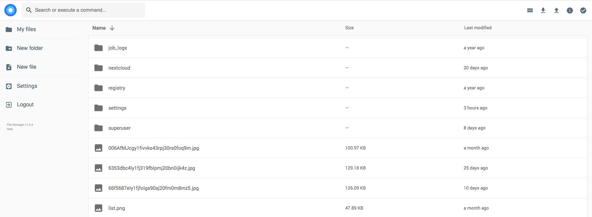

Aria2 + AriaNg + Filebrowser

English | [简体中文](https://github.com/wahyd4/aria2-ariang-docker/blob/master/README.CN.md)

[](https://microbadger.com/images/wahyd4/aria2-ui "Get your own image badge on microbadger.com")
[](https://hub.docker.com/r/wahyd4/aria2-ui/)
[](https://github.com/wahyd4/aria2-ariang-docker/actions)


**If you like this project, please consider [sponsoring me](https://github.com/sponsors/wahyd4) / 如果喜欢本项目，请考虑打赏，谢谢！**


- [Features](#features)
- [Recommended versions](#recommended-versions)
- [How to run](#how-to-run)
  - [Quick run](#quick-run)
  - [Full features run](#full-features-run)
  - [Run with docker-compose](#run-with-docker-compose)
  - [Supported Environment Variables](#supported-environment-variables)
  - [Supported Volumes](#supported-volumes)
- [Auto HTTPS enabling](#auto-https-enabling)
- [Download Automation 🤖](#download-automation-)
  - [Download file through iPhone/Mac Shortcuts app.](#download-file-through-iphonemac-shortcuts-app)
  - [Download file through cURL](#download-file-through-curl)
- [Build the image by yourself](#build-the-image-by-yourself)
- [Docker Hub](#docker-hub)
- [Running it on Kubernetes (My favorite)](#running-it-on-kubernetes-my-favorite)
- [Running it with Docker compose](#running-it-with-docker-compose)
- [FAQ](#faq)

One Docker image for file downloading, managing, sharing, as well as video playing and evening cloud storage synchronization.

Furthermore, it's pretty small and ARM CPU compatible which means you can also run it on Raspberry Pi🍓.

Last but not least, Auto HTTPS can't be more easy!

AriaNG


File Browser


## Features

  * [Aria2 (SSL support)](https://aria2.github.io)
  * [AriaNg](https://github.com/mayswind/AriaNg)
  * [Rclone](https://rclone.org/)
  * [File Browser](https://filebrowser.org/): Files mangement and videos playing
  * Auto HTTPS （Let's Encrypt）
  * Bind non root user into container, so non root user can also manage downloaded files.
  * Basic Auth
  * Support ARM CPUs as well, all supported CPU platforms can be found [here](https://cloud.docker.com/repository/docker/wahyd4/aria2-ui/tags)
  * Cloud Storage platforms synchronization
  * Auto uploading files to 3rd party Cloud storage providers via Rclone after files been downloaded.

## Recommended versions

* wahyd4/aria2-ui:latest

> Docker will pick proper CPU ARCH for you. e.g. arm64v8 or x86_64

## How to run

### Quick run

```shell
  docker run -d --name aria2-ui -p 8000:80 wahyd4/aria2-ui
```

* Aria2: <http://yourip:8000>
* Caddy File Server(Read Only) <http://yourip:8000/ro>
* FileManger: <http://yourip:8000/files>
* Rclone: <http://yourip:8000/rclone>
* For the initial `admin` password of Filebrowser, please check the docker logs you should see something like `User 'admin' initialized with randomly generated password: xxx`, then use that password to login Filebrowser.
* And use `user`/`password` to login `Rclone` if you don't update `ARIA2_USER` and `ARIA2_PWD`

> **Port note:** this command works without setting `ARIA2_EXTERNAL_PORT`. AriaNg derives the aria2 RPC port from the page's own URL. Set `ARIA2_EXTERNAL_PORT` only when the browser reaches the app through a different port than the one serving the page.

> **Security notice:** the quick run command above exposes AriaNg, FileBrowser and Rclone without authentication. For anything reachable from the internet, set `ENABLE_AUTH=true`, a strong `ARIA2_PWD`, a `RPC_SECRET`, and serve it over HTTPS (for example `DOMAIN=https://example.com`). AriaNg should be loaded from the same origin as the RPC endpoints (the default Caddy setup does this); cross-origin frontends need `rpc-allow-origin-all=true` in their own `aria2.conf`. Note that `ENABLE_AUTH` protects AriaNg, the read-only `/ro` browser, and the aria2 RPC endpoints only: `/files` keeps File Browser's own admin login, and `/rclone` keeps its `ARIA2_USER`/`ARIA2_PWD` login.
>
> **Note:** File Browser was archived upstream on 2026-09-01 and no longer receives security fixes. This image pins its final release (`v2.63.23`); evaluate an alternative for long-term use.

### Full features run

Create the host folders and files first. In particular, create an empty file for the File Browser database: if the host path does not exist, Docker creates a directory at `/app/filebrowser.db` and the container fails to start. Copy the whole `conf/` folder from a checkout of this repository — `aria2.conf` calls `/app/conf/auto-upload.sh` and `/app/conf/aria2-sample-hook.sh`, so copying only `aria2.conf` and `aria2.session` leaves those hooks missing.

```bash
  mkdir -p /yourdata /yourcache /yourcaddy /yourconf
  cp -r conf/. /yourconf/
  touch /yourdata/filebrowser.db

  docker run -d --name ariang \
  -p 80:80 \
  -p 443:443 \
  -p 6881-6999:6881-6999/tcp \
  -p 6881-6999:6881-6999/udp \
  -e PUID=1000 \
  -e PGID=1000 \
  -e ENABLE_AUTH=true \
  -e RPC_SECRET=Hello \
  -e DOMAIN=https://example.com \
  -e ARIA2_USER=user \
  -e ARIA2_PWD=password \
  -e CADDY_LOG_LEVEL=ERROR \
  -v /yourdata:/data \
  -v /yourcache:/app/.cache \
  -v /yourdata/filebrowser.db:/app/filebrowser.db \
  -v /yourcaddy:/app/.caddy \
  -v /yourconf:/app/conf \
  wahyd4/aria2-ui
```

`ARIA2_SSL` is deprecated and ignored, so this example no longer mounts `/app/conf/key`: Caddy terminates TLS and aria2's RPC binds to `127.0.0.1` only. `ARIA2_EXTERNAL_PORT` is also omitted because AriaNg derives `443` from `https://example.com`; set it only when the browser reaches the app through a different port than the one serving the page.
### Run with docker-compose

If you would like to get rid of those annoying command line commands, then just put the following sample content into `docker-compose.yaml`
```yaml
version: "3.5"
services:
  aria2-ui:
    restart: unless-stopped
    image: wahyd4/aria2-ui:latest
    environment:
      - ENABLE_AUTH=true
      - ARIA2_USER=user
      - ARIA2_PWD=password
      - DOMAIN=http://toozhao.com
    ports:
      - "80:80"
    volumes:
      - ./data:/data
```
Then simply run `docker-compose up -d`, that's it!

### Supported Environment Variables
| ENV | Description|
|:---|:---|
| `ENABLE_AUTH` | Whether to enable Basic auth for AriaNg, the read-only `/ro` browser, and the aria2 RPC endpoints. Values: `true` or `false`. It does **not** protect `/files` (File Browser) or `/rclone` (Rclone); those keep their own logins. Default: `false` |
| `ENABLE_RCLONE` | Whether to disable Rclone, if you running this container offline or do not have stable connection to Github, please set to `false` |
| `ENABLE_FILEBROWSER` | Whether to disable Filebrowser, set it to `false` to disable it, by default it's enabled |
| `ARIA2_USER` | Basic Auth username, Rclone GUI uses it as well. Default value: `user` |
| `ARIA2_PWD` | Basic Auth password, Rclone GUI uses it as well. Default value: `password` |
| `ARIA2_EXTERNAL_PORT` | Optional. The public port the browser uses to reach AriaNg. When unset, AriaNg derives the RPC port from the page's own URL. Setting it overrides the derived value; only set it when the browser reaches the app through a different port than the one serving the page. Default: unset |
| `ARIA2_SSL` | **Deprecated and ignored.** aria2's RPC binds to `127.0.0.1` and Caddy terminates TLS, so the old certificate setup (`/app/conf/key`) has no effect. Setting it only logs a warning. |
| `PUID` | Bind Linux UID into container which means you can use non `root` user to manage downloaded files, default UID is `1000`. Must be consistent with `PGID`: either both are `0` (run as root) or both are non-zero (run as the user); mixed values abort startup. |
| `PGID` | Bind Linux GID into container, default GID is 1000 |
| `RPC_SECRET` | The Aria2 RPC secret token. Must not contain newlines or start/end with whitespace (aria2 trims config values, which would desynchronise AriaNg and the RPC). |
| `DOMAIN` | The domain you'd like to bind, when domain is a `https://` thing, then auto TLS feature will be enabled |
| `RCLONE_CONFIG_BASE64` | Inject `rclone.conf` as a `base64` string, for platforms that only accept environment variables and cannot mount `/app/conf`. Encode it with `cat /path/to/rclone.conf \| base64` or any base64 tool such as [this](https://www.base64encode.org/). Set `ENABLE_RCLONE=true` as well. |
| `ENABLE_APP_CHECKER` | By default it's set to `true` to check if any new docker image version release on daily basis, which can help you get notification when new features released as well as some security vulnerabilities get fixed. You can set it to `false` to disable this feature. Note: you still need to manually pull the new image version and re run the docker container to complete upgrading. |
| `CADDY_LOG_LEVEL` | For specifying the log level of Caddy, set it to `WARN` or`ERROR` to reduce logs. Default: `INFO` |
| `CADDY_FILE_SERVER_BROWSE_HTML` | The HTML template Caddy uses for the read-only file browser at `/ro`. Default: `/app/browse.html` |
| `RCLONE_AUTO_UPLOAD_PROVIDER` | The Rclone remote storage provider name, which can be found under `Rclone -> Configs`, default `""`, which means auto upload is disabled. When the value is not empty, then the files will be attempted to be uploaded.|
| `RCLONE_AUTO_UPLOAD_REMOTE_PATH` | The file folder in remote cloud storage provider, default `/downloads`|
| `RCLONE_AUTO_UPLOAD_FILE_MIN_SIZE` | Set the minimum file size of auto uploader, files smaller than it won't be uploaded, default `1K`  |
| `RCLONE_AUTO_UPLOAD_FILE_MAX_SIZE` | Set the limit of the Max file can be uploaded to 3rd party storage provider, default `100G`. |
| `FIX_DATA_VOLUME_PERMISSIONS` | Default value is `false`. When set to `true`, the container will run `chown -R` command against `/data` folder and `PUID` and `PGID` you set. Please set it to `true` when container complains you don't have enough permissions to manage the files and folders you mounted.|

Invalid configuration now stops the container with a non-zero exit code instead of letting it run in a broken state — for example an unsupported `ENABLE_AUTH` value, or `ENABLE_AUTH=true` with an empty `ARIA2_PWD`.


### Supported Volumes

| Mountable folder | Description|
|:---|:---|
| `/data` | The folder contains all the files you download. |
| `/app/conf/key` | **Deprecated.** Previously stored the aria2 RPC certificate (`aria2.crt`) and key (`aria2.key`). aria2's RPC now binds to `127.0.0.1` and Caddy terminates TLS, so this mount no longer has any effect. |
| `/app/conf` | aria2 configuration, the download session, rclone config, and the hook scripts. Mount the **whole** `conf/` folder from this project: `aria2.conf` calls `/app/conf/auto-upload.sh` (on download complete) and `/app/conf/aria2-sample-hook.sh` (on download error), so copying only `aria2.conf` and `aria2.session` breaks those hooks. For the first run `aria2.session` can be an empty file. If you don't mount `/app/conf`, download progress survives a container restart but is lost when the container is recreated or upgraded. Supported files: `aria2.conf`, `aria2.session`, `rclone.conf`, `auto-upload.sh`, `aria2-sample-hook.sh`. |
|`/app/conf/aria2.conf` | See description above👆🏼 |
|`/app/conf/aria2.session` | See description above👆🏼 |
|`/app/conf/rclone.conf` | See description above👆🏼 |
| `/app/conf/auto-upload.sh` | The bash script to be used for uploading downloaded files to remote storage provider via Rclone, mount your own script if you want to have custom logic. |
| `/app/filebrowser.db` | File Browser's settings database, including the `admin` account and its password. Create an empty file on the host first; otherwise Docker creates a directory and File Browser cannot start. It is lost when the container is recreated or upgraded unless mounted. |
| `/app/.caddy` | Caddy's data directory, including the Let's Encrypt certificates and keys it obtains. Mount it to keep certificates across container recreation and avoid re-issuing them. |
| `/app/.cache` | The folder for storing rclone caches and [aria2 DHT files](https://aria2.github.io/manual/en/html/aria2c.html#cmdoption-dht-file-path) |


## Auto HTTPS enabling

Make sure you have added proper `A` record point to the host you running to your domain `DNS` record list, then just add `e` option to bind the `https` domain when you run the image

```bash
docker run -d --name aria2-ui -p 80:80 -p 443:443 -e DOMAIN=https://toozhao.com wahyd4/aria2-ui
```
## Download Automation 🤖

### Download file through iPhone/Mac Shortcuts app.

First [Download Shortcut](https://www.icloud.com/shortcuts/7483b8cec7484c0f98b72882d0f1e3e2), then follow the promots to setup aria2-ui URL and RPC_SECRET. Then you are all ready to go, just to run the shortcut and provide the file URL which you want to download or the magnet/torrent file URL.

### Download file through cURL

```bash
curl -u user:password https://example.com/jsonrpc \
  -d '{"jsonrpc":"2.0","id":"someID","method":"aria2.addUri","params":["token:Hello",["http://some_file_url"],{"dir":"/data"}]}'
```

Replace `example.com` with the host and published web port from your run command (`https://` implies 443; otherwise include `:port`). The credentials above match the full-features example: `ENABLE_AUTH=true`, `ARIA2_USER=user`, `ARIA2_PWD=password`, and `RPC_SECRET=Hello`.

## Build the image by yourself

```bash
 docker build -t aria2-ui .
```

`docker build` builds for your host architecture and loads the image into your local Docker. For a multi-platform image, add `--push` (or `--load` for a single platform) to `docker buildx build`; without either flag the result only stays in the build cache and is not available to `docker run`.

## Docker Hub

  <https://hub.docker.com/r/wahyd4/aria2-ui/>

## Running it on Kubernetes (My favorite)

First of all, I have to say running this docker image on Kubernetes is more challenging and requires more knowledges than running it in raw Docker, but which is more powerful.
I couldn't tell you how to run it in Kubernetes step by step, but once you have a running Kubernetes cluster(You can install Kubernetes via `minikube`, `Docker desktop app`, `kubeadm` and many other tools.), then you can modify the [k8s-manifest.yaml](k8s-manifest.yaml) to satisfy all your requirements. Such as:

* NFS PV provider(Use your NAS as storage)
* Ingress access, Oauth login, more access controls via Nginx etc.
* VPN tunnel (Secure your traffic)
* Sidecars and so on.

## Running it with Docker compose

  Please refer <https://github.com/wahyd4/aria2-ariang-x-docker-compose>


## FAQ
  1. `Aria2 Status Disconnected` usually means the browser cannot reach the RPC endpoint on the port AriaNg assumed. By default AriaNg derives the port from the page URL, so `-p 8000:80` or an HTTPS reverse proxy works without extra settings. Set `ARIA2_EXTERNAL_PORT` only when the browser reaches the app through a different port than the one serving the page, then recreate the container.
  2. If there is no speed at all when you downloading a BitTorrent file, please try to use a popular torrent file first to help the application to cache `DHT` file. Then the speed should get fast and fast, as well as downloading other links. Also publish the BitTorrent port range (`-p 6881-6999:6881-6999/tcp -p 6881-6999:6881-6999/udp`); without inbound peers DHT and peer counts stay low, so downloads are slow.
  3. If you see any errors related to `setcap` which probably means the Linux you are running doesn't support running this application with `non-root` user. So please specify the `PUID` and `PGID` to `0` explicitly to use `root` user to run it.
  4. How can I get `Rclone` authenticated? Due to Rclone is running in this docker image only as a component rather than an application, you can only interact with it via `/rclone` endpoint, and no other ports. So the web browser authentication mechanism doesn't work here. Please configure Rclone through command line within the container. You can follow the official doc [Configuring rclone on a remote / headless machine](https://rclone.org/remote_setup) or this [issue](https://github.com/wahyd4/aria2-ariang-docker/issues/118)
  5. Why the app stopped working when I have `- v /<some-folder>:/app/conf` mounted. It happens when you mount the entire `/app/conf` folder but you don't have any files under that folder on your host. Copy the **whole** [`conf`](https://github.com/wahyd4/aria2-ariang-docker/tree/master/conf) folder to your local folder and rerun the container — not just `aria2.conf` and `aria2.session`. `aria2.conf` invokes `/app/conf/auto-upload.sh` and `/app/conf/aria2-sample-hook.sh`, so those scripts must be present too.
